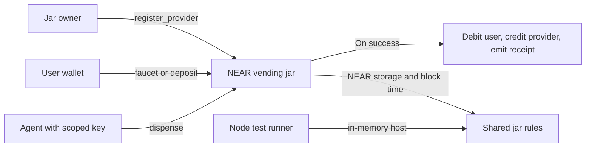

# Quarters

Quarters is a pay-per-use AI tool companion. The Phase 1 NEAR contract gives each user a mock-USDC Coin Jar and applies spending limits to agent purchases of research and chart renders. The primary hackathon track is Agent Economy (`agents`). The secondary track is AI Security & Defense (`security`).

## Problem

People who need an occasional premium AI result often pay for an entire subscription. Giving an agent a wallet to make individual purchases also gives untrusted prompts a path to trigger spending. Quarters separates each tool purchase from the user's wallet authority and caps the agent's spending on-chain.

## How to try it

1. From the repository root, run `npm run test:contract` with Node.js 20 or later. See the dependency-free harness exercise the same JavaScript rules used by the NEAR contract.
2. Follow the faucet and dispense tests. See a new account receive 5,000,000 mock-USDC micro-units once and a 50,000-unit purchase credit the provider and emit one structured receipt, even when retried.
3. Follow the limit tests. See an unregistered provider, a $10 attempt, and a purchase above $2 in a rolling 24-hour window rejected. At the exact 24-hour boundary, the oldest purchase drops out of the calculation.

## Architecture

Prices are integer micro-units. The owner sets a ceiling per provider and tool pair. The contract charges the direct caller, enforces the hard 250,000-unit cap and the 2,000,000-unit rolling limit, and binds each receipt to the caller's request ID. A repeated request with identical purchase terms returns the original receipt. The rolling window uses cumulative checkpoints and a binary search over block timestamps.

`deposit` is a Testnet demonstration that credits one mock dollar for each attached testnet NEAR, in whole demo micro-units. Deposits stay in the contract account and the provider credit is internal demo accounting. Use `faucet` for the standard flow.

## Build and Testnet setup

On Linux or macOS, run `npm ci` and `npm run build:contract` to produce `build/vending_jar.wasm`. The NEAR JavaScript SDK installs its build toolchain as part of `npm ci`. The local harness requires only Node.js.

For a Testnet deployment, use the contract account to deploy and call `init` with `{"owner_id":"YOUR_OWNER_ACCOUNT"}`. Use the owner account to register each provider and tool pair. For example, set a `price_ceiling` of `"50000"` for research and `"30000"` for chart rendering. Use the user's wallet to call `faucet` before an agent purchase.

Create the agent's key on the user's Testnet account with the contract as its receiver, `dispense` as its sole allowed method, and a finite gas allowance. The user's wallet keeps its own key. NEAR rejects native transfer actions and attached deposits signed by the scoped key. The contract separately enforces the purchase policy after NEAR accepts a function call. The local harness verifies the purchase rules against in-memory storage. Demonstrating key rejection requires an actual NEAR runtime. See [NEAR access keys](https://docs.near.org/protocol/accounts-contracts/access-keys).

## Links

Phase 1 runs locally. The Testnet deployment, MCP and HTTP 402 integration, consumer frontend, and demo recording are future phases.

## Dependencies and license

The contract uses the official [NEAR JavaScript SDK](https://github.com/near/near-sdk-js). The harness uses Node's built-in test runner. See [LICENSE](LICENSE).
